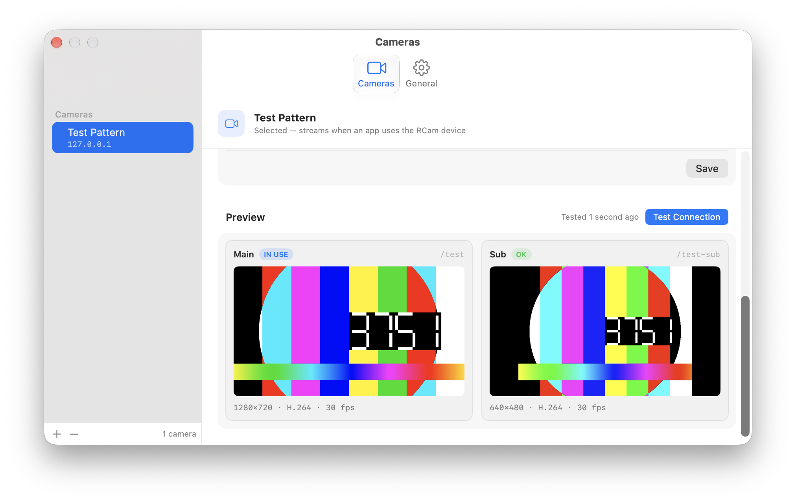
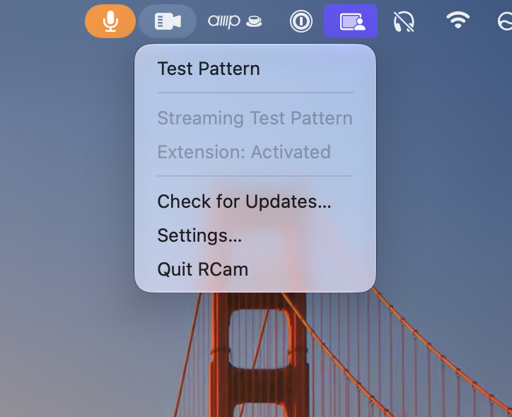
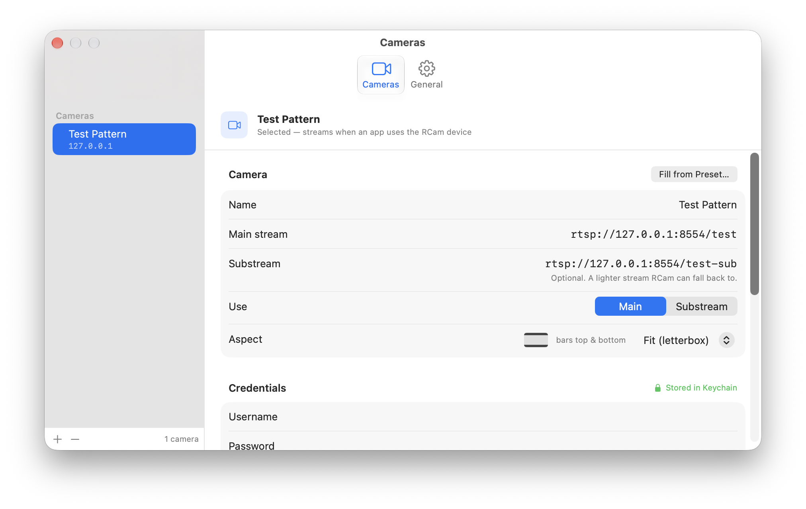

# RCam

A macOS menu bar app that turns RTSP camera streams (security cams, IP cams) into a virtual camera — RCam — usable in Zoom, Meet, FaceTime, QuickTime and anything else that takes a camera.

RCam is free and open source under the [MIT License](LICENSE). Website: <https://rcam.strawdynamics.com>





<details>
<summary>More screenshots</summary>



</details>

## Install

1. Download the latest `RCam-<version>.dmg` from [Releases](https://github.com/strawdynamics/rcam/releases/latest).
2. Open it and drag **RCam** into **Applications**. RCam has to run from `/Applications`: macOS only installs camera extensions from there. If you open it from the disk image or your Downloads folder, RCam tells you so, shows itself in Finder and quits.
3. Open RCam from Applications. It installs its camera extension on first launch.
4. Approve the extension when macOS asks, in System Settings › General › Login Items & Extensions › Camera Extensions.
5. Add a camera in RCam's Settings. The first time RCam connects to a camera on your network, macOS asks for Local Network access. Allow it, or RCam can't reach the camera. If you denied it earlier, turn RCam back on in System Settings › Privacy & Security › Local Network.

Then pick **RCam** as the camera in your video app.

### Requirements

- A Mac with Apple Silicon
- macOS 15 or later

### Updates

RCam checks for updates automatically (via [Sparkle](https://sparkle-project.org)) and asks before installing one. It won't interrupt you with an update while a call is using the camera. Use **Check for Updates…** in the menu bar menu to check now, or turn automatic checks off in Settings › General.

### Uninstall

1. In RCam's Settings › General, click **Remove…** next to *Virtual camera extension*. The RCam camera disappears from every app right away.
2. Quit RCam and move it to the Trash.

macOS finishes removing a camera extension at the next restart. Until then, `systemextensionsctl list` in Terminal still shows RCam's extension as `[terminated waiting to uninstall on reboot]`. That's expected; it's gone after a restart.

## How it works

Two halves:

- **RCam** (menu bar app): connects to the selected camera over RTSP (TCP), demuxes with a minimal FFmpeg build, hardware-decodes H.264 via VideoToolbox, and pushes 1920×1080@30 NV12 frames into the extension's sink stream via the CoreMediaIO C API. Camera config lives in JSON (no credentials); credentials live in the Keychain.
- **RCamExtension** (CMIO camera extension): owns a 30 Hz clock and always emits a frame — fresh sink frame, last-good frame, or a rendered placeholder — so clients never see a stall, even if the stream (or the app) dies mid-call.

The app only holds an RTSP connection while something is actually watching the virtual camera, and disconnects after a short grace period. Reconnects use exponential backoff and handle sleep/wake.

## Building

Requires Xcode, [XcodeGen](https://github.com/yonaskolb/XcodeGen), and an Apple Silicon Mac (arm64 only). See [CONTRIBUTING.md](CONTRIBUTING.md) for signing setup, including how to build and test without an Apple Developer account.

```sh
scripts/build.sh
```

This regenerates the Xcode project, bumps the extension version, builds, and installs `RCam.app` into `/Applications` (the extension can only activate from there). On first launch, approve the extension in System Settings.

The vendored FFmpeg libs (demux-only, no decoders) are prebuilt in `vendor/ffmpeg/`; rebuild them with `scripts/build-ffmpeg.sh` if needed. They are shared libraries, embedded in `RCam.app/Contents/Frameworks` and replaceable in place — LGPL-2.1 §6(b), which is what lets RCam ship FFmpeg in a signed app bundle at all.

## Development

- `scripts/testrig.sh {start|stop}` — local mediamtx + ffmpeg rig serving synthetic H.264 test streams at `rtsp://127.0.0.1:8554/{test,test-sub}`.
- `rcamcli` — dev CLI: `probe-device` verifies the virtual camera end-to-end, `capture` tests the RTSP decode path in isolation.
- `scripts/test.sh` — runs `RCamTests`.

See [CONTRIBUTING.md](CONTRIBUTING.md) for the full workflow.

## Layout

| Path | Contents |
|---|---|
| `RCam/` | Menu bar app, settings UI, config/Keychain, sink writer, updater |
| `RCamExtension/` | CMIO extension: device, streams, emit loop, placeholders |
| `RCamKit/` | Shared code: `FrameSource` protocol, `RTSPSource` decode pipeline |
| `RCamTests/` | Unit tests |
| `rcamcli/` | Dev/test CLI |
| `scripts/` | Build, release, FFmpeg vendoring, test rig |
| `site/` | Landing page and Sparkle appcast, deployed to GitHub Pages |

## License

RCam is released under the [MIT License](LICENSE). Copyright (c) 2026 Straw Dynamics.

RCam bundles [FFmpeg](https://ffmpeg.org) libraries under the LGPL-2.1; see Settings › General › Acknowledgements in the app and `scripts/build-ffmpeg.sh` for the build recipe.
